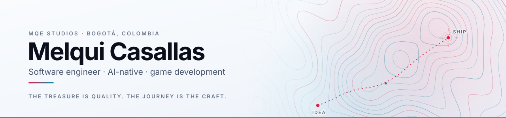

<picture>
  <source media="(prefers-color-scheme: dark)" srcset="https://raw.githubusercontent.com/Melqui56/Melqui56/main/assets/banner-dark.svg">
  <source media="(prefers-color-scheme: light)" srcset="https://raw.githubusercontent.com/Melqui56/Melqui56/main/assets/banner-light.svg">
  
</picture>

**Software engineer.** I build systems close to the metal — Rust emulators and tools, Go backends, game loops — and document the decisions that keep them shippable.

[mc16casallas@gmail.com](mailto:mc16casallas@gmail.com) · [mqestudios.com](https://mqestudios.com) · [LinkedIn](https://www.linkedin.com/in/melquisedec-casallas/)

  

## What I do

- **Rust systems** — emulators, GPU paths, launchers and tooling; deterministic, performance-aware architecture.
- **Backend & platform** — Go APIs, PostgreSQL, Docker and Cloudflare; architecture recorded as ADRs.
- **AI-native engineering** — AI in the loop for architecture, code, tests and docs; every output verified.
- **Game development & design** — LÖVE/Lua loops, procedural content; Unity level design; UI/UX as a system.

## Now

- Software engineer at **Creacta** — open to engineering roles from January 2027 and studio collaborations.
- Building **Riume** (ARM64 emulator, Vulkan GPU path) and **Hondana** (TV-style emulator launcher) — Rust, private for now.
- BSc Software Engineering (Uniminuto, 2026); AI specialization, game design & development postgrad and digital design — in progress.

## How I work

> Decision over framework. Tools change; the reasoning is the asset.

- **Ship, then verify** — every claim gets a test, a benchmark or a deploy.
- **Depth over quantity** — few things, done and documented well.
